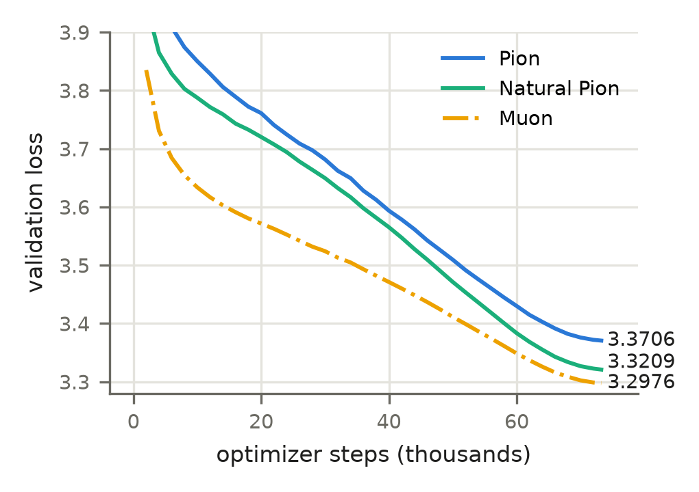
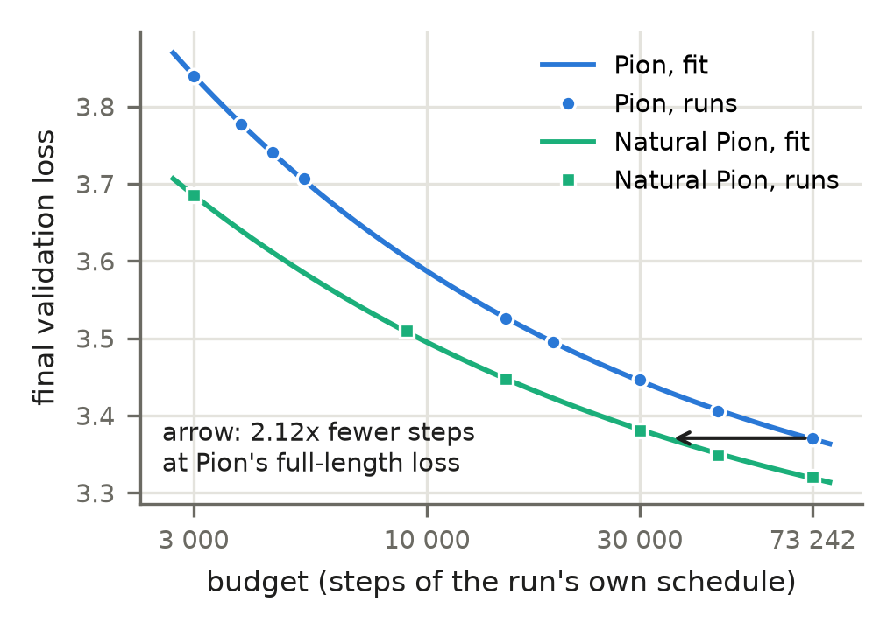

## Abstract

Pion trains each weight matrix of a language model only by rotating it on both sides,
$W \leftarrow R_{\mathrm{out}} W R_{\mathrm{in}}$, so the singular values of every matrix stay fixed for the
whole run. We keep this constraint and change the direction of the rotation from the gradient to the
natural gradient. On LLaMA-60M trained on 9.6B tokens of C4, the resulting optimizer, **Natural Pion**,
reaches a validation loss of 3.3209 in Pion's number of steps, against Pion's 3.3706 (one seed;
3.3667 with Pion's AdamW learning rate re-tuned at full length): 66%–68%
of the way to Muon (3.2976, not re-tuned), which does not keep the spectrum. With each
method on its own full schedule, it needs 1.90–2.12x fewer steps (power-law fit) to reach the losses Pion reaches at
15 000 to 73 242 steps.

The method rests on three results. First, on the rotation generators the Kronecker-factored (K-FAC)
Fisher information takes a closed form, $F(X) = \tfrac12(SXA + AXS)$. Here $A$ is the second moment of
the layer's inputs and $S$ that of its output gradients pulled back through $W$. A single generalized
eigendecomposition per side inverts this operator exactly. Second, the natural gradient is a good
direction with a bad scale: its magnitude varies widely between matrices. We keep the
direction and take the length from Pion's own rule, which fixes the RMS of the change the step makes to the
weight. Third, these rotations reach angles at which Pion's truncated exponential no longer preserves the spectrum: the
squared Cayley retraction, the exponential map by scaling and squaring of a Cayley step computed by Newton–Schulz,
keeps it to $3.7 \cdot 10^{-6}$ of each matrix's scale at the same loss. The method costs 1.09x Pion's floating-point operations per step (1.08x its time on one GPU in
our implementation).

---

## 1 Introduction

Most optimizers for neural networks move a weight matrix additively, $W \leftarrow W - \eta\,\Delta$.
They differ in how $\Delta$ is preconditioned: per coordinate (Adam), by Kronecker factors (K-FAC,
Shampoo), or by orthogonalizing it (Muon). Pion (Shi et al., 2026) takes a different route. It
updates $W$ multiplicatively, by an orthogonal equivalence transformation

$$W \leftarrow R_{\mathrm{out}}\, W\, R_{\mathrm{in}}, \qquad R_{\mathrm{out}} \in O(m),\; R_{\mathrm{in}} \in O(n),$$

so the singular values of $W$ are those it was initialised with, for the whole of training. Only
the singular vectors are learned. Every weight's spectral norm, and with it the Lipschitz constant of every linear
map in the network, is therefore fixed at its initial value for the whole run, without weight decay or a norm
constraint to hold it there. Pion reports that this makes training stable and that the optimizer is a competitive
alternative to Adam and Muon for LLM pretraining and finetuning (Shi et al., 2026).

Pion chooses the rotation by steepest descent on the rotation group: it follows the Riemannian
gradient of the loss with respect to the two generators. Steepest descent depends on the metric, and
Pion's is the Euclidean one on the generators, which treats every direction of rotation alike. But the curvature of the loss along
different rotation directions, and across layers, can differ widely. The classical remedy
is the natural gradient (Amari, 1998): steepest descent in the metric of the model's output
distribution, the Fisher information. This paper derives the natural gradient for Pion's parameterization in the K-FAC approximation, inverts it
exactly and cheaply, and pairs it with Pion's own step-length rule.

**Where this places the method.** Muon (Jordan et al., 2024) reaches a lower loss than Pion in Pion's own
comparisons and in ours, but it leaves the spectrum free. Within the class of optimizers that keep every weight's
spectrum fixed, Natural Pion improves on Pion and closes 68% of its gap to Muon at full length
(Section 5.2; Muon at the Pion authors' settings, not re-tuned here, so a tuned Muon would lower that share). How much
of the rest is the price of the constraint we do not know; the paragraph above is what the constraint buys. The retraction does not enter this trade: every retraction we tried gives the same loss, and ours is
the one that actually keeps the spectrum (Section 4.1).

**Contributions.**

1. **The Fisher on rotation generators, in closed form.** Under the K-FAC independence
   approximation, the Fisher information restricted to the rotations of $W$ is
   $F(X) = \tfrac12(SXA + AXS)$ on each side (Proposition 1). Its factors are the input second
   moment $A$ and the output-gradient second moment $D$ pulled through $W$, $S = W^\top D W$. The structure has a
   simple origin: a single token's rotation gradient is a bivector, the wedge product of two vectors.
2. **Exact inversion.** One generalized eigendecomposition per side diagonalises $F$, and the
   solve becomes an elementwise division (Proposition 2). The only regularisation is a relative
   floor on the eigenvalues.
3. **Direction from the Fisher, length from Pion.** We take only the direction of $F^{-1}G$ and keep Pion's
   step-length rule. With the same rule and the same momentum, the natural gradient reaches 3.6878 at
   3 000 steps against 3.8199 for Pion's raw generator (Pion itself: 3.8412).
4. **A retraction that keeps the spectrum at our angles.** The squared Cayley retraction (scaling and squaring for the
   exponential, matrix products only) keeps the spectrum to $3.7 \cdot 10^{-6}$ of each matrix's scale after 3 000
   steps; Pion's degree-2 truncated exponential, accurate at Pion's small angles, moves it by $5.0 \cdot 10^{-3}$ at ours.
   The loss is the same with either (Section 4.1, Table 2).
5. **A fast implementation, Natural Pion Fast.** Amortised refreshes, statistics collected only where they are read,
   batching, the squared Cayley retraction and lower precision before the rotation take the step from
   1.22 s to 0.498 s, 2.5x faster, with a loss +0.001 from Algorithm 1's (mean of four seeds; this
   includes every change of Section 4, the retraction among them). Section 4 gives the chain and the cost in FLOPs,
   Appendix C the time and loss of each change.
6. **Experiments.** On LLaMA-60M / C4 at Pion's full 9.6B-token budget, the validation-loss gap to
   Pion at equal steps is 0.050 (0.155 at 3 000 steps over four seeds), and Natural Pion needs
   1.90–2.12x fewer steps. The ablations of Section 5.4 vary one component at a time.

---

## 2 Background

### 2.1 Pion: training by orthogonal equivalence

Let $W \in \mathbb{R}^{m \times n}$ be a weight matrix with loss gradient $G = \partial L / \partial W$.
Pion parameterises an update by two skew-symmetric generators,
$\Omega_{\mathrm{in}} \in \mathfrak{so}(n)$ and $\Omega_{\mathrm{out}} \in \mathfrak{so}(m)$, and moves

$$W(\Omega) = e^{\Omega_{\mathrm{out}}}\, W\, e^{\Omega_{\mathrm{in}}}.$$

The derivative at $\Omega = 0$ is $\Omega_{\mathrm{out}} W + W \Omega_{\mathrm{in}}$. Write
$\langle M, N \rangle = \operatorname{tr}(M^\top N)$ and $\operatorname{skew}(M) = \tfrac12(M - M^\top)$.
For skew $\Omega$, $\langle M, \Omega\rangle = \langle \operatorname{skew}(M), \Omega\rangle$, so

$$dL = \langle G W^\top, \Omega_{\mathrm{out}}\rangle + \langle W^\top G, \Omega_{\mathrm{in}}\rangle
\quad\Longrightarrow\quad
G_{\mathrm{in}} = \operatorname{skew}(W^\top G), \qquad G_{\mathrm{out}} = \operatorname{skew}(G W^\top)$$

are the gradients of the loss with respect to the two generators: the Riemannian gradient on
$O(m) \times O(n)$ at the identity.

Pion steps along $-G_{\mathrm{in}}$ and $-G_{\mathrm{out}}$ with three further ingredients:

* **Lie-algebra momentum.** An exponential moving average of $G_{\mathrm{in}}$ and $G_{\mathrm{out}}$.
* **RMS scaling.** The step is scaled so that the RMS of the induced change
  $W\Omega_{\mathrm{in}} + \Omega_{\mathrm{out}} W$ equals a target (0.2 times the learning rate).
* **A truncated exponential retraction** $e^{\Omega} \approx I + \Omega + \Omega^2/2$.

Both rotations are applied at every step (the *bilateral* update; Pion also describes an alternating
variant, which it finds slightly worse at 60M). Embeddings, the output head and normalization
gains are trained by AdamW. Only the 2-D weights inside the transformer blocks are rotated.

### 2.2 The natural gradient and K-FAC

For a model with predictive distribution $p_\phi(y \mid x)$, the Fisher information
$F = \mathbb{E}[\nabla_\phi \log p\, \nabla_\phi \log p^\top]$ defines a metric on parameter space. The
natural gradient $F^{-1}\nabla L$ is the steepest-descent direction in that metric (Amari, 1998):

$$-F^{-1}\nabla L \;\propto\; \arg\min_{\Delta}\; \langle \nabla L, \Delta\rangle
\quad \text{s.t.} \quad \tfrac12 \Delta^\top F \Delta \le r .$$

In a language model the "examples" of this expectation are token positions. A linear layer $y = Wx$
sees one input vector $x_t$ and receives one output gradient $\delta_t = \partial \ell_t / \partial y_t$
per token $t$, and its weight gradient is the average of the per-token outer products
$\delta_t x_t^\top$. K-FAC (Martens & Grosse, 2015) assumes $x$ and $\delta$ are independent, which gives
$F_W \approx A \otimes D$ with $A = \mathbb{E}_t[x_t x_t^\top]$ and $D = \mathbb{E}_t[\delta_t\delta_t^\top]$.
As an operator on matrices, $F_W(Z) = D Z A$.

Strictly, the Fisher averages over outputs $y$ sampled from the model. Like most K-FAC
implementations, we use the **empirical Fisher**: $\delta_t$ is the gradient of the training loss at
the observed next token (Section 5.4 compares it with the true Fisher).

---

## 3 Method

### 3.1 The Fisher on rotation generators

We derive the Fisher of the input-side generator $\Omega_{\mathrm{in}} \in \mathfrak{so}(n)$ in five
steps; the output side follows by symmetry.

**Step 1: the Fisher as a covariance on $\mathfrak{so}(n)$.** By Section 2.1, the gradient of token
$t$'s loss with respect to $\Omega_{\mathrm{in}}$ is

$$g_t = \operatorname{skew}(W^\top \delta_t\, x_t^\top) \in \mathfrak{so}(n).$$

The (empirical) Fisher on $\mathfrak{so}(n)$ is the second moment of $g_t$. A second moment of
elements of a vector space is a linear operator on that space:

$$F_{\mathrm{in}}(X) = \mathbb{E}_t\big[\langle g_t, X\rangle\, g_t\big], \qquad X \in \mathfrak{so}(n),$$

so that $\langle X, F_{\mathrm{in}}(X)\rangle = \mathbb{E}_t[\langle g_t, X\rangle^2]$ is the variance of
the directional derivative along $X$. In coordinates this is an $\tfrac{n(n-1)}{2} \times
\tfrac{n(n-1)}{2}$ matrix, about $1.7\cdot10^{10}$ entries for $n = 512$, and it cannot be stored, let
alone inverted.

**Step 2: each token's generator is a bivector.** Write $u_t = W^\top \delta_t \in \mathbb{R}^n$, the
output gradient pulled back to the input space. Then

$$g_t = \tfrac12\big(u_t x_t^\top - x_t u_t^\top\big) = \tfrac12\, u_t \wedge x_t,$$

the antisymmetrised outer product of two vectors. Its pairing with a skew $X$ is a single bilinear
form: since $x^\top X u = -u^\top X x$,

$$\langle g_t, X\rangle = \tfrac12\big(u_t^\top X x_t - x_t^\top X u_t\big) = u_t^\top X x_t .$$

**Step 3: expand.** Substituting both expressions into Step 1 and moving the scalar
$u_t^\top X x_t$ next to the vector it pairs with:

$$F_{\mathrm{in}}(X) = \tfrac12\,\mathbb{E}_t\big[(u_t^\top X x_t)\, u_t x_t^\top\big]
- \tfrac12\,\mathbb{E}_t\big[(u_t^\top X x_t)\, x_t u_t^\top\big]
= \tfrac12\,\mathbb{E}_t\big[u_t u_t^\top\, X\, x_t x_t^\top\big]
- \tfrac12\,\mathbb{E}_t\big[x_t x_t^\top\, X^\top u_t u_t^\top\big].$$

**Step 4: the K-FAC assumption.** Assume, as K-FAC does, that the layer's input $x_t$ and its output
gradient $\delta_t$ (hence $u_t$) are independent. The expectation of each product then factorises:

$$\mathbb{E}_t\big[u u^\top X x x^\top\big] = \mathbb{E}[u u^\top]\, X\, \mathbb{E}[x x^\top] = S X A,
\qquad
\mathbb{E}_t\big[x x^\top X^\top u u^\top\big] = A X^\top S,$$

with $A = \mathbb{E}[x x^\top]$ and $S = \mathbb{E}[u u^\top] = W^\top \mathbb{E}[\delta\delta^\top] W = W^\top D W$.

**Step 5: simplify.** With $X^\top = -X$ the two terms add:

$$F_{\mathrm{in}}(X) = \tfrac12\big(S X A - A X^\top S\big) = \tfrac12\big(S X A + A X S\big).$$

**The output side.** For $\Omega_{\mathrm{out}} \in \mathfrak{so}(m)$, token $t$'s generator is
$\operatorname{skew}(\delta_t x_t^\top W^\top) = \tfrac12\,\delta_t \wedge v_t$ with $v_t = W x_t$, the input
pushed forward to the output space. Steps 2-5 are unchanged with $(u, x)$ replaced by $(\delta, v)$, and
$\mathbb{E}[v v^\top] = W A W^\top$.

**Proposition 1 (Fisher on the generators).** Under the K-FAC independence assumption, and treating
the two sides separately,

$$F_{\mathrm{in}}(X) = \tfrac12\big(S X A + A X S\big), \qquad S = W^\top D W,$$
$$F_{\mathrm{out}}(Y) = \tfrac12\big(D Y V + V Y D\big), \qquad V = W A W^\top,$$

for $X \in \mathfrak{so}(n)$, $Y \in \mathfrak{so}(m)$. Both operators are self-adjoint and positive
semi-definite on the skew matrices: $\langle Z, SXA + AXS\rangle$ is symmetric in $X$ and $Z$, and
$\langle X, F_{\mathrm{in}}(X)\rangle = \mathbb{E}[(u^\top X x)^2] \ge 0$ before the factorisation and
$\tfrac12\langle X, SXA + AXS\rangle = \|S^{1/2} X A^{1/2}\|_F^2 \ge 0$ after it. $\square$

**Relation to K-FAC.** The operator we derived turns out to be K-FAC itself, written on the rotation
generators. The change of $W$ caused by a generator is $J(\Omega) = W\Omega$, whose adjoint onto
$\mathfrak{so}(n)$ is $J^*(M) = \operatorname{skew}(W^\top M)$. Pulling K-FAC's Fisher on $W$,
$F_W(Z) = DZA$, back through this map gives

$$J^* F_W J(X) = \operatorname{skew}(W^\top D\, W X\, A) = \operatorname{skew}(S X A) = \tfrac12\big(SXA + AXS\big),$$

which is Proposition 1: K-FAC written on the generators. It is not a Kronecker product, so K-FAC's
inverse $D^{-1} Z A^{-1}$ does not apply; Section 3.2 inverts it.

**Remarks.**

* **What is approximated.** Three things: the independence of $x$ and $\delta$ (Step 4, as in K-FAC);
  the coupling between the two sides and between layers (dropped); and the empirical Fisher in place
  of the true one (Section 2.2). Everything after Step 4 is exact algebra.
* **Size.** The operator of Step 1 has $O(n^4)$ entries. Proposition 1 fixes it by two $n \times n$
  matrices.
* **The output gradient enters both sides.** It appears on the input side through $S = W^\top D W$,
  and the input moment appears on the output side through $V = W A W^\top$.
* **Numerical check.** We checked Proposition 1 against a Monte Carlo estimate with independent $x$
  and $\delta$: relative error 0.7% (in) and 0.4% (out) at $4 \times 10^5$ samples. The pull-back identity holds to $4 \cdot 10^{-15}$ (`scripts/analysis/check_fisher.py`).

### 3.2 Exact inversion

$F_{\mathrm{in}}$ acts on a space of dimension $n(n-1)/2$. Solving $F_{\mathrm{in}}(X) = G$ as a dense
linear system costs $O(n^6)$, about $10^{15}$ operations for $n = 512$, at every refresh of every matrix.
Nor is $F_{\mathrm{in}}$ the map $X \mapsto SXA$, whose inverse would be $S^{-1} G A^{-1}$: the sum of the
two orderings does not factor unless $S$ and $A$ commute. It is nonetheless diagonalised by a
congruence, which brings the cost to $O(n^3)$.

**Proposition 2 (Inversion).** Let $A \succ 0$ and $S \succeq 0$, and let $P$ solve the generalized
eigenproblem $P^\top A P = I$, $P^\top S P = \Lambda = \operatorname{diag}(\lambda)$, with $\lambda_i + \lambda_j > 0$
for all $i \neq j$ (the diagonal of a skew matrix is zero). For skew $G$, the unique skew solution of $F_{\mathrm{in}}(X) = G$ is

$$X = P\, \big[ (P^\top G P) \oslash K \big]\, P^\top, \qquad K_{ij} = \tfrac12(\lambda_i + \lambda_j),$$

where $\oslash$ is elementwise division.

*Proof.* Substitute $X = P\tilde X P^\top$:
$P^\top (SXA + AXS) P = (P^\top S P)\, \tilde X\, (P^\top A P) + (P^\top A P)\, \tilde X\, (P^\top S P) = \Lambda \tilde X + \tilde X \Lambda$.
So $F_{\mathrm{in}}(X) = G$ becomes $\tfrac12(\lambda_i + \lambda_j)\, \tilde X_{ij} = (P^\top G P)_{ij}$. Since
$P^\top G P$ is skew, so are $\tilde X$ and $X$. $P$ is invertible, so the solution is unique. $\square$

Neither $A$ nor, on the output side, $D$ need be definite; the floor below makes them so, which the proposition needs.

**Computation.** We compute $P = A^{-1/2} Q$, with $Q$ the eigenvectors of $A^{-1/2} S A^{-1/2}$. The
symmetric root, rather than a Cholesky factor, exposes the eigenvalues so they can be floored.

**Regularisation.** It is a single relative floor: every spectrum the solve uses ($A$, $S$, $\Lambda$
on the input side; $D$, $V$, $\Lambda$ on the output side) is raised to at least $\varepsilon \lambda_{\max}$, with $\varepsilon = 10^{-3}$. A
floor leaves every eigenvalue above it exact, which an additive shift does not.

**Cost.** One generalized eigendecomposition per side, $O(n^3)$, at every refresh (Section 4 amortises it); applying
$F^{-1}$ between refreshes costs four matrix products per side.

The same construction applies to the output side, with $A$ replaced by $D$ and $S$ by $V = WAW^\top$.

### 3.3 Step length

The natural gradient fixes a direction $X = F^{-1}G$. Its scale is a poor guide: with a fixed step size, the rotation
angle that $X$ actually takes spans a factor of $3.8 \cdot 10^{7}$ across the rotated matrices (90th over 10th percentile, Section 5.4). The scale is also where
K-FAC is least reliable: along our step, its curvature is 0.029 of the exact per-token curvature on a
trained model (`scripts/probes/paper_checks.py`). We keep the direction and take the length from Pion: the
coefficient $c$ makes the RMS of the change the step induces in $W$ equal to the scheduled $\theta_t$,

$$c_t = \theta_t\, \frac{\sqrt{mn}}{\|W X_{\mathrm{in}} + X_{\mathrm{out}} W\|_F},$$

the rule Pion applies to its raw generators. Both sides share $c$, so the ratio $F^{-1}$ sets between them is kept,
and within a matrix the rotation planes turn in proportion to the singular values of $X$, to first order in the angle. $\theta_t$ follows a cosine
schedule from a peak $\theta_0$. Section 5.4 compares the rule with fixing the rotation angle instead
($c = \theta/\sigma(X)$) and with the length in the Fisher metric.

**Proposition 3 (Angle of a Cayley step).** Let $X$ be skew with largest singular value $\sigma$ and
$c > 0$. The rotation $R = \big(I + \tfrac c2 X\big)^{-1}\big(I - \tfrac c2 X\big)$ turns its planes by
the angles $2\arctan(c\,\sigma_j/2)$, where $\sigma_j$ are the singular values of $X$. Its largest
angle is $2\arctan(c\sigma/2) = c\sigma + O((c\sigma)^3)$.

*Proof.* A real skew matrix has eigenvalues $\pm i\sigma_j$, in planes that are mutually orthogonal.
On such a plane $R$ acts by $(1 - ic\sigma_j/2)/(1 + ic\sigma_j/2) = e^{-2i\arctan(c\sigma_j/2)}$.
$\square$

Under the RMS rule $c\sigma$ is not fixed: a plane that carries little of $W$
moves $W$ little and may turn far.
At the worst logged step early in training, a tenth of the matrices turn their fastest plane by 0.64 rad
or more (90th percentile over the matrices), which is what the retraction has to handle. Over the first thousand
steps, where both are measured, the median angle is 4.0 times Pion's (from 2.7 to 8.6; Figure 1).


### 3.4 Retraction and spectrum preservation

**Proposition 4.** For skew $\Psi$, the Cayley map $R = (I + \Psi)^{-1}(I - \Psi)$ is orthogonal
for every scale of $\Psi$. Hence $R_{\mathrm{out}} W R_{\mathrm{in}}$ has exactly the singular values
of $W$. The degree-2 truncated exponential $T = I + \Psi + \Psi^2/2$ satisfies
$T^\top T = I + \Psi^4/4$.

*Proof.* The eigenvalues of a real skew $\Psi$ are $\pm i\sigma_j$, so those of $I + \Psi$ are
$1 \pm i\sigma_j \neq 0$ and $I + \Psi$ is invertible. $I + \Psi$ and $I - \Psi$ commute, and
$(I \pm \Psi)^\top = I \mp \Psi$, so
$R^\top R = (I + \Psi)(I - \Psi)^{-1}(I + \Psi)^{-1}(I - \Psi) = I$. For $T$, expand with
$\Psi^\top = -\Psi$: the odd and quadratic terms cancel, leaving $\Psi^4/4$. $\square$

**What the retraction must do.** Stay orthogonal to round-off at every angle the steps take, on every matrix and every
step. Pion's angles are smaller and uneven: median over the rotated matrices 0.026 rad per step (p90/p10
2.0), largest 0.097 (`scripts/probes/pion_angles.py`, first 1 058
steps). By Proposition 4, one step of the truncated exponential at angle $a$ changes a singular value by
$\sqrt{1 + a^4/4} - 1 \approx a^4/8$: about $6 \cdot 10^{-8}$ at Pion's typical angle, and at the angles of our method
(3 000 steps; median over the run of the 50th / 90th percentile over the matrices, and the largest 90th percentile)
$4 \cdot 10^{-7}$, $9 \cdot 10^{-6}$ and $2 \cdot 10^{-2}$ per step.

**Precision.** The retraction must run in true fp32: over 200 exact Cayley steps at angle $10^{-2}$ on a
$512 \times 1376$ matrix, TF32 moves a singular value by up to 0.37% (relative), fp32 by 0.012%.

### 3.5 The algorithm

**Algorithm 1: Natural Pion** (exact form; one rotated matrix $W \in \mathbb{R}^{m\times n}$, all of
them processed alike). Everything is recomputed at every step; Section 4 makes it fast.

```
state:  A, D (EMAs of x x^T and of d d^T, fp32; initialised by their first observation),
        beta_A = 0.95, beta_D = 0.5, beta1 = 0.9, eps = 1e-3,
        M_in, M_out (momentum, initialised at zero), bases (P, lambda) per side
every step t:
    theta_t <- theta_min + (theta_0 - theta_min) (1 + cos(pi t / T)) / 2         cosine, theta_min = theta_0 / 100
    forward: A <- beta_A A + (1 - beta_A) mean_tokens(x x^T)
    backward: D <- beta_D D + (1 - beta_D) mean_tokens(d d^T)     d = per-token output gradient
    (P_in, lambda_in)   <- gen_eig(A, W^T D W)                      the bases (Prop. 2); every spectrum
                                                                    floored at eps * lambda_max
    (P_out, lambda_out) <- gen_eig(D, W A W^T)
    G_in  <- skew(W^T G);   G_out <- skew(G W^T)
    M_in  <- beta1 M_in  + (1 - beta1) G_in
    M_out <- beta1 M_out + (1 - beta1) G_out
    X_in  <- P_in  [ (P_in^T  M_in  P_in)  / K_in  ] P_in^T          K_ij = (lambda_i + lambda_j)/2
    X_out <- P_out [ (P_out^T M_out P_out) / K_out ] P_out^T
    c     <- theta_t sqrt(m n) / ||W X_in + X_out W||_F               Pion's RMS rule
    W     <- Cay(c X_out) W Cay(c X_in),   Cay(cX) = (I + cX/2)^-1 (I - cX/2), exact solve
```

Embedding, output head and normalization gains use AdamW, as in Pion. The rotated matrices get no
weight decay: a rotation cannot change their norm, and their spectrum is fixed by construction.

A constant factor in $A$ or $D$ (e.g. autograd's $1/N$) cancels in $cX$ under the RMS rule; the Fisher-norm and
quadratic-model rules and the damping of Section 5.4 need $D$ at its true scale (Appendix A).

---

## 4 Natural Pion Fast

Algorithm 1 costs 1.22 s per step in our setting, against Pion's 0.473 s; the basis refresh,
two generalized eigendecompositions per matrix at every step, takes about half of it (Table C.1). Natural Pion Fast
takes it to 0.498 s with five changes. Appendix C gives each with what it saves and what it costs in loss:

* **Amortised refresh** (C.2). The bases are recomputed every 25 steps, as K-FAC recomputes its inverse every 20
  iterations.
* **Statistics only where they are read** (C.3). $A$ and $D$ are accumulated, with an EMA of 0.5, only in the 6 steps
  before a refresh.
* **Batching** (C.4, C.5). $F^{-1}$, the Cayley step and the RMS scale run as one call per matrix shape; the step's
  largest angle comes from a warm-started power iteration.
* **Cheaper statistics, lower precision before the rotation** (C.6). One $A$ per input tensor, bf16 inputs to the grams
  with fp32 accumulation; the products that only set the direction in bf16 and TF32, the rotation itself in fp32.
* **The squared Cayley retraction** (Section 4.1), matrix products in place of the exact Cayley solve.

Unless stated otherwise, numbers are at 3 000 steps, seed 0, Lie momentum 0.9, on one RTX PRO 6000; seconds per step
are the mean time between logged steps of the training runs themselves, without the slowest and fastest tenth
(evaluation pauses).

*Table 1. From Algorithm 1 to Natural Pion Fast (s / step: time between logged steps of each training run, evaluation
excluded; the last row groups the changes of Appendix C.4–C.6 and Section 4.1).*

| step | s / step | val (3 000 steps, seed 0) |
|---|---|---|
| Algorithm 1 | 1.22 | 3.6860 |
| refresh every 25 steps (C.2) | 0.668 | 3.6903 |
| + statistics only before a refresh (C.3) | 0.568 | 3.6867 |
| **+ batching by shape, batched scale and $\sigma$, one $A$ per input, bf16 statistics inputs, lower precision before the rotation, squared Cayley (C.4–C.6, 4.1)**: Natural Pion Fast | **0.498** | **3.6878** |

Over four seeds, Algorithm 1 averages 3.6840 and Natural Pion Fast 3.6848; at 15 000 steps
(seed 0, each at the method's 15 000-step scale), 3.4458 against 3.4465. One of the changes alters
the step itself, not only its cost: Algorithm 1's exact Cayley step turns a plane by $2\arctan(c\sigma_j/2)$, the
squared Cayley step by about $c\sigma_j$ (Section 4.1).

**Algorithm 2: Natural Pion Fast.** It is Algorithm 1 with the bases refreshed every 25 steps; $A$ and $D$
accumulated (EMA 0.5) only in the 6 steps before a refresh, one $A$ per input tensor, their inputs in bf16 with fp32
accumulation; $F^{-1}$ batched by shape, its products in bf16; the RMS scale and $\sigma$ (warm power iteration, 2
iterations, 50 after a refresh) batched; the squared Cayley retraction; TF32 for the other
products before the rotation, and the Cayley step and the rotation of $W$ in fp32. A step takes 1.08x Pion's time on our GPU.[^cost] Its peak GPU memory is
43.02 GB against Pion's 42.26 GB (+0.76 GB for $A$, $D$, the bases and the momentum).

[^cost]: Seconds per step come from one job on one GPU (RTX PRO 6000), every configuration in turn for 600 steps of
the 3 000-step schedule without evaluation, Pion first and last (`scripts/paper/timing.sbatch`).

### 4.1 The squared Cayley retraction

$\mathrm{Cay} = 2(I + \Psi)^{-1} - I$ with $\Psi = \tfrac c2 X$, and $(I + \Psi)^{-1}$ can be computed by Newton–Schulz,
$Z \leftarrow Z(2I - (I + \Psi)Z)$ from $Z_0 = I - \Psi$, with matrix products only. After two iterations the error is
$2(I+\Psi)^{-1}\Psi^8$; the largest entry of $R^\top R - I$ is $5 \cdot 10^{-9}$ at angle $a = c\|X\|_2 = 0.2$, $10^{-6}$ at 0.4, $3 \cdot 10^{-4}$ at 0.8 (fp64).

In fp32 this standard form is biased: entries next to 1 lose their low bits, always in the same direction, and
$\|W\|_F^2$, which a rotation keeps, grows by a median $6.8 \cdot 10^{-6}$ per training step (exact solve
$2.0 \cdot 10^{-7}$; `scripts/probes/ns_diag.py`). Carried in $\Phi = Z - I$ from $\Phi_0 = -\Psi$ (residual
$E = \Psi + \Phi + \Psi \Phi$, $\Phi \leftarrow \Phi - E - \Phi E$, rotation $I + 2\Phi$) nothing is next to 1, with the same number of
products. Over random rotations ($1376 \times 1376$, angle 0.05), $\operatorname{tr}(R^\top R - I)/n$ averages
$+1.7 \cdot 10^{-7}$ for the exact solve (171 standard errors from zero), $+1.4 \cdot 10^{-6}$ for standard
Newton–Schulz and $+6.3 \cdot 10^{-11}$ (0.7 standard errors) in this form
(`scripts/probes/retraction_bias.py`).

**Scaling and squaring.** Two iterations are exact to fp32 only for angles up to about 0.2, and the RMS rule takes
larger ones. Natural Pion Fast halves the step's largest angle (from $\sigma$, Appendix C.5) $q$ times until it is at most
0.2, runs the two iterations on $\Psi / 2^q$, and squares the rotation $q$ times in the same correction form: with
$R = I + H$, $H \leftarrow 2H + H^2$, so again nothing is rounded next to 1. It costs one product per squaring, fewer
than the extra iterations or the exact solve it replaces (`scripts/probes/cayley_speed.py`).

The result, $R = \mathrm{Cay}(cX / 2^q)^{2^q}$, is no longer the Cayley transform of $cX$. Cayley is the $[1/1]$ Padé
approximant of the exponential, so this is the scaling-and-squaring method for the matrix exponential (Higham, 2005)
with that approximant: an approximation of the exponential map, the geodesic step on $O(n)$. We call it the squared
Cayley retraction; each Cayley factor is computed by Newton–Schulz in $Z - I$ as above. On the plane of singular
value $\sigma_j$ it turns by $2^{q+1}\arctan(c\sigma_j / 2^{q+1})$; with $y = c\sigma_j/2^q \le 0.2$ this is the
exponential's angle $c\sigma_j$ to a relative $y^2/12 \le 1/300$, at any step length (Proposition 3 applies to each
factor, not to $R$). With exact Cayley factors it is orthogonal, because a diagonal Padé approximant maps a skew matrix to an orthogonal one;
a truncated Taylor series, Pion's approximation of the same exponential, does not (Proposition 4). In practice each
factor carries the error of its Newton–Schulz inverse, which the squarings multiply by up to $2^q$; in training the
spectrum moves by $3.7 \cdot 10^{-6}$ of its scale over 3 000 steps (Table 2). For most of the run the 90th percentile of the angle is below 0.2 (median
0.09 rad), so the squarings act mainly early in training.

*Table 2. Retractions: Natural Pion Fast with each, seed 0. First column: change of $\|W\|_F^2$ over 200 steps of a bare
$1376 \times 1376$ rotation at angle 0.05 (`scripts/probes/ns_rounding.py`). Drift: $\max_i |s_i - s_i^0| / \max_i s_i^0$
after 3 000 training steps, median / worst over the rotated matrices (`scripts/probes/retraction_drift.py`).*

| retraction | $\Delta\|W\|_F^2$, bare matrix | val, 3 000 steps | val, 15 000 steps | drift | s / step |
|---|---|---|---|---|---|
| Cayley, exact solve | $+3.4 \cdot 10^{-5}$ | 3.6826 | | $4.0 \cdot 10^{-4}$ / $4.4 \cdot 10^{-4}$ | 0.533 |
| Cayley, Newton–Schulz (standard form, iterations growing with the angle, no squaring) | $+2.8 \cdot 10^{-4}$ | 3.6775 | | $5.2 \cdot 10^{-3}$ / $1.9 \cdot 10^{-2}$ | 0.495 |
| squared Cayley (Natural Pion Fast) | $+1.6 \cdot 10^{-7}$ | 3.6878 | 3.4465 | $3.7 \cdot 10^{-6}$ / $4.8 \cdot 10^{-6}$ | 0.498 |
| truncated exponential, degree 2 (Pion's) | | 3.6830 | 3.4459 | $5.0 \cdot 10^{-3}$ / $2.2 \cdot 10^{-2}$ | 0.483 |

The validation losses of the four retractions lie within 0.010 of each other at 3 000 steps (one run
each; the method's four seeds span 0.006); at 15 000 steps the truncated exponential is
-0.0006 from the method. The retraction decides the spectrum, not the
loss: the squared Cayley retraction moves it by $3.7 \cdot 10^{-6}$, the others by $4.0 \cdot 10^{-4}$ to $5.2 \cdot 10^{-3}$.

### 4.2 Cost in floating-point operations

Seconds depend on the GPU and on the implementation; operations do not. Table 3 counts them (model:
$6 \times$ tokens $\times$ matrix parameters, plus attention; statistics over the first micro-batch; eigendecompositions
at $9n^3$; `scripts/analysis/flops.py`).

*Table 3. Optimizer FLOPs per step as a share of the model's forward and backward pass; the last row is the ratio of
whole training steps. The squared Cayley retraction is counted at two Newton–Schulz iterations; the squarings of
early large-angle steps are not counted.*

| | LLaMA-60M |
|---|---|
| Pion | 1.2% |
| Natural Pion Fast | 10.5% |
| of which statistics / $F^{-1}$ / Cayley / refresh | 5.7% / 1.9% / 1.9% / 0.4% |
| of which generators and rotation (as Pion) | 0.5% |
| whole training step, Natural Pion Fast / Pion | 1.09 |

$F^{-1}$ and Cayley cost $O(n^3)$ per matrix and step against the model's $O(Nn^2)$ for $N$ tokens, so their share
grows with width at a fixed batch. With data parallelism the forward and backward pass divides among the GPUs;
the optimizer's matrices must be divided among them too (one GPU per matrix), or, replicated on every GPU as
Pion's step is, their share grows with the number of GPUs. Statistics are the largest term in FLOPs but run on tensor cores in bf16; eigendecompositions are the
smallest but latency-bound, which is why Tables C.5 and 3 rank the parts differently.

---

## 5 Experiments

### 5.1 Setup

| | |
|---|---|
| model | LLaMA-style (Touvron et al., 2023), 60M parameters: hidden 512, 8 layers, 8 heads, SwiGLU FFN 1376 (Shazeer, 2020), RoPE (Su et al., 2024), RMSNorm (Zhang & Sennrich, 2019), vocabulary 32 100 (T5 tokenizer) |
| data | C4 (Raffel et al., 2020), sequence length 256, batch 512 sequences (131 072 tokens per step) in two micro-batches of 256 |
| budget | 73 242 steps = 9.6B tokens: Pion's 60M budget |
| rotated | the 56 matrices inside the blocks (43.5% of parameters) |
| the rest | AdamW (Loshchilov & Hutter, 2019), lr 8e-3, chosen for Pion from {4e-3, 8e-3, 1.6e-2} at 3 000 and 15 000 steps (the Pion script drives AdamW with its single lr, 1e-3); betas (0.9, 0.95), weight decay 0.1, cosine to 1%; the same for every method |
| precision | bf16 model; Natural Pion: statistics from bf16 inputs with fp32 accumulation, $F^{-1}$ products in bf16, other products before the rotation in TF32, the Cayley step and the rotation of $W$ in fp32 |
| metric | validation loss: token cross-entropy on held-out C4, in nats |
| hardware | one NVIDIA RTX PRO 6000 Blackwell per run |

**Baseline.** Pion's rotation update in its published settings: Lie momentum 0.9, RMS scale 0.2,
truncated exponential, bilateral update, cosine schedule; the other parameters use AdamW as in the table above, the
same for both methods. The Pion paper chose lr $10^{-3}$ from $\{10^{-4}, 5\cdot10^{-4}, 10^{-3}, 5\cdot10^{-3}, 10^{-2}\}$. As
Natural Pion's scale is chosen per budget, so is Pion's lr: the better of $10^{-3}$ and $2\cdot10^{-3}$ (seed 0) at every
budget from 15 000 steps on; Table 4 shows a wider grid at 3 840 and 19 200 steps.

*Table 4. Pion learning rate (validation loss, seed 0).*

| Pion steps | 5e-4 | 1e-3 | 2e-3 | 4e-3 |
|---|---|---|---|---|
| 3 840 | 3.8413 | 3.7804 | 3.7805 | 4.1464 |
| 19 200 | - | 3.4960 | 3.4862 | 3.8366 |

All comparisons are within one code base and one data pipeline (Muon's run below uses a copy of it). In our setting Pion ends at a training loss
of 3.3735 (mean over the last 2 000 steps; validation 3.3706); the Pion paper reads 3.3575 off
its own training curve in Megatron-LM (Shoeybi et al., 2019); a single batch's training loss varies by
0.026 here, so the two numbers are not directly comparable, and we compare within our setting only.

**Natural Pion.** Natural Pion Fast (Algorithm 2), Lie momentum 0.9, floor $\varepsilon = 10^{-3}$. Every schedule of
every method, $\theta$ and AdamW's lr alike, is a cosine down to 1% of its peak, Pion's $10^{-5}$ at lr $10^{-3}$. The
peak RMS scale $\theta_0$ is chosen per horizon on a grid of factors of two: $6.0 \cdot 10^{-4}$ at 3 000 steps,
$3.0 \cdot 10^{-4}$ at 9 000, $3.0 \cdot 10^{-4}$ at 15 000 and $3.0 \cdot 10^{-4}$ at 30 000; the longer budgets keep the
30 000-step choice.

### 5.2 Main result

*Table 5. Equal number of steps (seed 0 unless marked). Pion at the better of lr $10^{-3}$ and $2\cdot10^{-3}$ at each budget
(Section 5.3); at 3 000 steps $10^{-3}$. Gap = val(Pion) - val(Natural Pion).*

| steps | Pion | Natural Pion | gap |
|---|---|---|---|
| 3 000 (mean of 4 seeds) | 3.8394 | 3.6848 | 0.155 |
| 15 000 | 3.5254 | 3.4465 | 0.079 |
| 73 242 (full length) | 3.3706 | 3.3209 | 0.050 |

At 3 000 steps the smallest per-seed gap is 0.153. Seed 0 also chose Natural Pion's scale; over seeds
1–3 alone its mean is 3.6839 at 3 000 steps and 3.4482 at 15 000. For reference, Muon (Jordan et al., 2024) in the
Pion authors' configuration (lr $10^{-3}$, same AdamW and schedule; micro-batch 512), which does not preserve the
spectrum, reaches 3.2976 at full length: 0.073 below Pion and 0.023 below Natural Pion.
The Pion paper also reports Muon ahead of Pion (its Table 1, 1.3B).



**AdamW at full length.** AdamW's lr (embeddings, head, norms) was chosen at 3 000 and 15 000 steps. At full length
the best of the three values below is $4 \cdot 10^{-3}$ for Pion and $8 \cdot 10^{-3}$ for Natural Pion,
0.004 and 0.000 better than $8\cdot10^{-3}$, and the gap stays between 0.042 and
0.050 (seed 0; Pion at the better of lr $10^{-3}$ and $2\cdot10^{-3}$ at each AdamW lr):

*Table 5b. Full length, by AdamW lr.*

| AdamW lr | Pion | Natural Pion | gap |
|---|---|---|---|
| $10^{-3}$ | 3.3786 | 3.3366 | 0.042 |
| $4\cdot10^{-3}$ | 3.3667 | 3.3235 | 0.043 |
| $8\cdot10^{-3}$ (the rest of the paper) | 3.3706 | 3.3209 | 0.050 |

### 5.3 Steps to reach Pion's loss

Every run below has its own full cosine schedule ending at its budget $B$, so no loss is read off the middle of
a schedule. For each method the final validation loss is fitted as $L(B) = a + bB^{-\gamma}$ (fitted constants $a$, $b$, $\gamma$) (9 Pion budgets,
6 Natural Pion budgets, four seeds at 3 000 and 15 000 steps; worst residual 0.0021), and the saving at Pion's
loss $L$ is $B_{\mathrm{Pion}} / B_{\mathrm{NP}}(L)$, with $B_{\mathrm{NP}}$ from the fit or from linear interpolation in $\log B$
between Natural Pion's budgets (`scripts/analysis/budget_fit.py`); Figure 3 shows both fits.

*Table 6. Steps saved at Pion's loss (mean over seeds where there are four): fit / interpolation.*

| Pion steps | Pion val | saving |
|---|---|---|
| 15 000 | 3.5254 | 1.90 / 1.84 |
| 19 200 | 3.4945 | 1.92 / 1.88 |
| 30 000 | 3.4460 | 1.97 / 1.96 |
| 45 000 | 3.4050 | 1.96 / 1.93 |
| 73 242 | 3.3706 | 2.12 / 2.16 |

Pion's targets are at its better lr of $10^{-3}$ and $2\cdot10^{-3}$ at each budget (Section 5.1). The gap in loss at equal
steps shrinks with the budget (0.155, 0.079, 0.050 at 3 000, 15 000 and 73 242 steps,
Table 5) because both curves flatten; measured in steps, the advantage does not shrink (1.90x at
15 000, 2.12x at full length).



**Equal wall-clock time.** With the step-time ratio of Section 4 (1.08), in the time of Pion's $B$ steps
Natural Pion takes $B/1.08$. These are estimates read off the budget curve above, not separate runs: the gap
to Pion at Pion's full-length wall-clock time is 0.047 (fit; 0.045 by
interpolation), at 19 200 steps' time 0.065, and at 3 840 steps' time 0.124.

### 5.4 Ablations

All ablations are on Natural Pion Fast at 3 000 steps, seed 0, and change one thing. The reference is the method
itself: RMS scale $6.0 \cdot 10^{-4}$, Lie momentum 0.9, floor $10^{-3}$ (3.6878). Where a row says "best", it is
the best over a grid of that row's step-size parameter.

**The direction: natural gradient against the raw generator.** Best scale of each grid. Same length rule, retraction
and schedule; only $X = F^{-1}G$ against $X = G$ changes.

*Table 7. The direction.*

| | no momentum | Lie momentum 0.9 |
|---|---|---|
| $X = F^{-1}G$ | 3.7590 | 3.6878 |
| $X = G$ | 4.2223 | 3.8199 |
| gain from $F^{-1}$ | 0.463 | 0.132 |

Pion at 3 000 steps: 3.8412.

**The length.** The method's configuration with only the length rule changed, best of each grid; $\theta$ is each rule's grid
parameter. The last column is the spread of the realised rotation angle across the rotated matrices (90th over 10th
percentile, median over the steps after 1 000). $F$ in the quadratic-model and Fisher-norm rules is the Fisher at the
current $W$ with the current statistics; with momentum $X = F^{-1}M$, so with a fresh basis $\langle X, FX\rangle = \langle M, X\rangle$, and the
quadratic-model ratio is $\langle G, X\rangle / \langle M, X\rangle$: it differs from a fixed $c$ where the current
gradient disagrees with the momentum and where the basis has gone stale.

*Table 8. The length rule.*

| length rule | val | angle spread |
|---|---|---|
| RMS of the induced change, as in Pion (the method) | 3.6878 | $2.8 \cdot 10^{0}$ |
| rotation angle: $c = \theta/\sigma(X)$, $X = F^{-1}M$ | 3.6892 | $1.0 \cdot 10^{0}$ |
| quadratic-model ratio, $c = \theta \min(1, \langle G, X\rangle / \langle X, FX\rangle)$ | 3.7260 | $8.1 \cdot 10^{1}$ |
| Fisher norm, $c = \theta / \sqrt{\langle X, FX\rangle}$ | 3.7343 | $1.0 \cdot 10^{2}$ |
| fixed, $c = \theta$ | 3.9946 | $3.8 \cdot 10^{7}$ |
| rotation angle before $F^{-1}$: $c = \theta/\sigma(M)$ | 4.5456 | $1.0 \cdot 10^{9}$ |

RMS rule minus angle rule, each at the best $\theta$ of its grid, over four seeds: -0.001, +0.000, -0.003, -0.001.

**Regularisation of the Fisher.** The default is a relative floor $\varepsilon = 10^{-3}$ (3.6878).

*Table 9. Regularisation of the Fisher.*

| floor $\varepsilon$ (no damping) | $10^{-6}$ | $10^{-5}$ | $10^{-4}$ | $10^{-2}$ |
|---|---|---|---|---|
| val | 3.7987 | 3.7465 | 3.6927 | 3.7176 |

| damping $\mu$ (floor $10^{-6}$; $F + \mu\lambda_{\max}(B)\, BXB$, $B$ = $A$ in, $D$ out) | $10^{-4}$ | $10^{-3}$ | $10^{-2}$ | $10^{-1}$ |
|---|---|---|---|---|
| val | 3.7068 | 3.6947 | 3.7124 | 3.7423 |

The best alternative differs from the default by +0.005.

**The true Fisher.** Drawing the targets from the model ($D$ from sampled outputs, one more forward and backward
pass) gives 3.6815, best of its scale grid, against 3.6878 for the empirical Fisher.

---

## 6 Related work

**Orthogonal equivalence training.** POET (Qiu et al., 2025), following orthogonal fine-tuning (Qiu et al.,
2023), reparameterises $W = R W_0 P$ with orthogonal $R$, $P$ built from skew-symmetric parameters by a
truncated Cayley–Neumann series; POET-X (Qiu et al., 2026) makes it memory- and compute-efficient. Pion (Shi et al.,
2026) turns the same principle into an optimizer, with updates in the Lie algebra. ISO (Zhu et al.,
2026) keeps the spectrum of a pretrained model fixed through a frame parameterisation $W = U\Sigma_0 V^\top$,
applies AdamW or Muon to the frames and retracts them by a polar map, for reinforcement learning from
verifiable rewards, and reports reaching Pion's final accuracy faster on Qwen3-4B. None of these
uses a curvature metric on the orbit: they move along the gradient with a first-order or orthogonalised
preconditioner. Natural Pion keeps Pion's manifold and changes the metric to the Fisher.

**Natural gradient on manifolds and Kronecker factorisations.** The natural gradient (Amari, 1998) has a
long line of approximations. K-FAC (Martens & Grosse, 2015) factorises the Fisher of a layer into input
and output-gradient moments; Shampoo (Gupta et al., 2018) builds Kronecker factors from the gradient
itself. On orthogonality-constrained parameters the natural Riemannian gradient goes back to ICA on
Stiefel manifolds (Amari, 1999), and gradient flows that preserve eigenvalues or singular values are
classical (Helmke & Moore, 1994, Ch. 2–3). Riemannian natural gradient methods (Hu et al., 2024) define the Fisher on a manifold's tangent
space, use a retraction, and work out a K-FAC-style Kronecker approximation for Grassmann manifolds.
Natural Pion is an instance of that framework on a different manifold, the orbit of a matrix under
two-sided rotations. There the K-FAC Fisher on the generators is the two-term operator of Proposition 1
rather than a Kronecker product, and Section 3.2 inverts it exactly. We did not find this operator, or a
natural gradient for orthogonal-equivalence updates, in prior work.

**Curvature-aware orthogonalised updates.** A recent family puts Kronecker curvature into Muon's
additive step. FISMO (Xu et al., 2026) fits Kronecker factors to gradient outer products and takes
$W \leftarrow W - \eta P^{-1/2}\,\mathrm{Polar}(\tilde G)\, Q^{-1/2}$ under a spectral-norm trust region in that
metric. Go-MUON (Che, 2026) applies Muon between inverse fourth roots of K-FAC's activation and
output-gradient moments. Mousse (Zhang et al., 2026) runs
Muon in Shampoo-whitened coordinates. All three are additive and change the weight spectrum; Natural
Pion's update is a rotation and keeps it.

**Orthogonalised additive updates.** Muon (Jordan et al., 2024) replaces the update by its orthogonal
polar factor, $W \leftarrow W - \eta\, UV^\top$, which equalises the update's singular values but
leaves the weight's spectrum free.

**Grafting.** Natural Pion is a graft: the direction of the natural gradient with the step length of Pion. Grafting
(Agarwal et al., 2020) takes the direction of one optimizer and the step size of another; Shampoo is run with it in
practice (Anil et al., 2020; Shi et al., 2023), and Eschenhagen et al. (2025) trace its role to the preconditioner's
stale and mis-scaled eigenvalues: a good direction with a bad scale, which is what we find for $F^{-1}$ (Section 3.3).
Muon and the modular norm (Large et al., 2024; Bernstein & Newhouse, 2024) set the step in the spectral norm; a
spectral rule in units of the rotation angle is one of the alternatives in Section 5.4.

**Retractions on the orthogonal group.** The Cayley transform is a standard retraction on the
orthogonal and Stiefel manifolds (e.g. Wen & Yin, 2013; Li, Li & Todorovic, 2020). Pion tested it and
reports modest gains over its truncated exponential; at Natural Pion's angles the squared Cayley retraction is what
keeps the spectrum (Section 4.1).

---

## 7 Limitations

* **Scale.** One model size (60M) and one data set. The full-length comparison is one seed; Table 5 gives four
  seeds at 3 000 steps.
* **One code base.** Our Pion ends 0.016 above the Pion paper's training loss; we compare within our
  setting only.
* **Exactness in practice.** In fp32 the exact Cayley solve changes the singular values by $+3.9 \cdot 10^{-4}$ (relative) on
  average over 3 000 steps, the squared Cayley retraction by $+2.6 \cdot 10^{-6}$.
* **Only Pion as a baseline.** We compare against Pion's published settings with its lr chosen per budget from
  $\{10^{-3}, 2\cdot10^{-3}\}$ and AdamW chosen for it at 3 000 and 15 000 steps (Table 5b at full length); Muon is shown for reference only, AdamW not at all, and only
  validation loss, not downstream tasks.
* **The peak scale depends on the horizon.** It is set per training length (Section 5.1), as a learning rate is.
* **Other choices were made at shorter horizons.** Lie momentum 0.9, $T_{\mathrm{fac}}$, the statistics window and
  the floor were chosen at 3 000 steps and are not re-tuned at full length; AdamW's lr was chosen at 3 000 and 15 000
  steps; Table 5b checks two smaller values at full length.
* **The K-FAC assumption.** Its curvature along our step is far from the exact one (Section 3.3); we keep only the
  direction of $F^{-1}G$.
* **Cost.** 1.09x Pion's step FLOPs at 60M; the share grows with width and, unless the matrices are
  divided among GPUs, with their number (Section 4.2).

**Future work.** Reinforcement learning from verifiable rewards, where a step costs minutes of
generation and the step efficiency of Section 5.3 is the relevant measure. The natural policy gradient
lineage (Kakade, 2001) makes it the natural test. Larger models, where the optimizer's $O(n^3)$ work has to be
divided across devices (at the shapes of a 1.7B model, one refresh of all matrices takes 58 s on one B200)
and can be cut further: on a rectangular $m \times n$ matrix ($m > n$) the wide side can be solved in $O(m^2 n)$
instead of $O(m^3)$, since rotations outside $W$'s column space do not move it.

---

## Acknowledgements

Computations were performed on the Aphrodite HPC system of The Cyprus Institute (project p330).

## References

- Agarwal, N., Anil, R., Hazan, E., Koren, T., Zhang, C. *Disentangling adaptive gradient methods from learning rates.* arXiv:2002.11803, 2020.
- Amari, S. *Natural gradient works efficiently in learning.* Neural Computation 10(2):251–276, 1998.
- Amari, S. *Natural gradient learning for over- and under-complete bases in ICA.* Neural Computation 11(8):1875–1883, 1999.
- Anil, R., Gupta, V., Koren, T., Regan, K., Singer, Y. *Scalable second order optimization for deep learning.* arXiv:2002.09018, 2020.
- Bernstein, J., Newhouse, L. *Old optimizer, new norm: an anthology.* OPT Workshop 2024; arXiv:2409.20325.
- Che, T. *Second-order Muon done right: a principled marriage of spectral geometry and curvature.* arXiv:2608.09763, 2026.
- Eschenhagen, R., Defazio, A., Lee, T.-H., Turner, R. E., Shi, H.-J. M. *Purifying Shampoo: investigating Shampoo's heuristics by decomposing its preconditioner.* NeurIPS, 2025. arXiv:2506.03595.
- Gupta, V., Koren, T., Singer, Y. *Shampoo: preconditioned stochastic tensor optimization.* ICML 2018.
- Helmke, U., Moore, J. B. *Optimization and Dynamical Systems.* Springer, 1994.
- Higham, N. J. *The scaling and squaring method for the matrix exponential revisited.* SIAM Journal on Matrix Analysis and Applications 26(4):1179–1193, 2005.
- Hu, J., Ao, R., So, A. M.-C., Yang, M., Wen, Z. *Riemannian natural gradient methods.* SIAM J. Sci. Comput. 46(1):A204–A231, 2024; arXiv:2207.07287.
- Jordan, K., Jin, Y., Boza, V., You, J., Cesista, F., Newhouse, L., Bernstein, J. *Muon: an optimizer for hidden layers in neural networks.* 2024. https://kellerjordan.github.io/posts/muon/
- Kakade, S. *A natural policy gradient.* NeurIPS 2001.
- Large, T., Liu, Y., Huh, M., Bahng, H., Isola, P., Bernstein, J. *Scalable optimization in the modular norm.* NeurIPS 2024; arXiv:2405.14813.
- Li, J., Li, F., Todorovic, S. *Efficient Riemannian optimization on the Stiefel manifold via the Cayley transform.* ICLR 2020, arXiv:2002.01113.
- Loshchilov, I., Hutter, F. *Decoupled weight decay regularization.* ICLR 2019; arXiv:1711.05101.
- Martens, J., Grosse, R. *Optimizing neural networks with Kronecker-factored approximate curvature.* ICML 2015, arXiv:1503.05671.
- Qiu, Z., Buchholz, S., Xiao, T. Z., Dax, M., Schölkopf, B., Liu, W. *Reparameterized LLM training via orthogonal equivalence transformation (POET).* NeurIPS 2025; arXiv:2506.08001.
- Qiu, Z., Liu, L., Weller, A., Shi, H., Liu, W. *POET-X: memory-efficient LLM training by scaling orthogonal transformation.* ICML 2026; arXiv:2603.05500.
- Qiu, Z., Liu, W., Feng, H., Xue, Y., Feng, Y., Liu, Z., Zhang, D., Weller, A., Schölkopf, B. *Controlling text-to-image diffusion by orthogonal finetuning.* NeurIPS 2023; arXiv:2306.07280.
- Raffel, C., et al. *Exploring the limits of transfer learning with a unified text-to-text transformer (C4, T5).* JMLR 2020.
- Shazeer, N. *GLU variants improve Transformer.* arXiv:2002.05202, 2020.
- Shi, H.-J. M., Lee, T.-H., et al. *A distributed data-parallel PyTorch implementation of the distributed Shampoo optimizer for training neural networks at-scale.* arXiv:2309.06497, 2023.
- Shi, K., Li, H., Qiu, Z., Wen, Y., Buchholz, S., Liu, W. *Pion: a spectrum-preserving optimizer via orthogonal equivalence transformation.* arXiv:2605.12492, 2026.
- Shoeybi, M., Patwary, M., Puri, R., LeGresley, P., Casper, J., Catanzaro, B. *Megatron-LM: training multi-billion parameter language models using model parallelism.* arXiv:1909.08053, 2019.
- Su, J., Ahmed, M., Lu, Y., Pan, S., Bo, W., Liu, Y. *RoFormer: enhanced Transformer with rotary position embedding.* Neurocomputing 568:127063, 2024; arXiv:2104.09864.
- Touvron, H., Lavril, T., Izacard, G., et al. *LLaMA: open and efficient foundation language models.* arXiv:2302.13971, 2023.
- Wen, Z., Yin, W. *A feasible method for optimization with orthogonality constraints.* Mathematical Programming 142:397–434, 2013.
- Xu, C., Yan, W., Zhang, Y.-J. A. *FISMO: Fisher-structured momentum-orthogonalized optimizer.* arXiv:2601.21750, 2026.
- Zhang, B., Sennrich, R. *Root mean square layer normalization.* NeurIPS 2019; arXiv:1910.07467.
- Zhang, Y., Xing, S., Huang, J., Lv, K., Zhou, Y., Qiu, X., Guo, Q., Chen, K. *Mousse: rectifying the geometry of Muon with curvature-aware preconditioning.* arXiv:2603.09697, 2026.
- Zhu, H., Cong, W., Sha, Z., et al. *ISO: an RLVR-native optimization stack.* arXiv:2607.19331, 2026.

---

## Appendix A: implementation details

* **Statistics.** $A$ is fed by a forward pre-hook on each rotated linear layer and $D$ by a hook on its
  output gradient, from one micro-batch per step. Both accumulate in fp32 with autocast disabled: a
  bf16 product that returns a bf16 matrix carries an entrywise error of about $2^{-8}$ of the largest entries, above
  the floor, and in training it even made eigenvalues of $A$ negative (step 499: thousands over the 56 matrices).
  Rounding only the inputs (Appendix C.6) does neither. The $1/N$ that autograd puts on a
  mean loss is undone by scaling $D$ by $N^2$.
* **Code.** `ngd_pion/natural_pion.py`: `NaturalPionFast` is Algorithm 2, the method of every experiment;
  Algorithm 1 is the same class with the basis rebuilt and the statistics collected every step and the exact Cayley
  solve (`t_fac` 1, `stats_window` null, `retraction` cayley; rows `c-alg1-*`). `NaturalPion` is the earlier
  reference with the angle rule $c = \theta/\sigma$, kept for the tests; every job and run record is listed in
  `scripts/paper/README.md` and `runs-record/`. Every measured number in this paper is computed from the run
  records by `scripts/analysis/paper_numbers.py` (the list, with sources, is `docs/paper/numbers.md`).

## Appendix B: hyperparameters

| | Natural Pion | Pion |
|---|---|---|
| rotated-matrix step | RMS rule, peak scale $\theta_0$ per horizon (Section 5.1), cosine to 1% of the peak | RMS rule, lr $10^{-3}$ or $2 \cdot 10^{-3}$ per budget (scale $0.2 \cdot$ lr), cosine to 1% |
| momentum | Lie, 0.9 | Lie, 0.9 |
| curvature | $T_{\mathrm{fac}}$ 25; $A$, $D$ EMA 0.5 over the 6 steps before a refresh; floor $10^{-3}$ | - |
| retraction | squared Cayley (Section 4.1) | truncated exponential, degree 2 |
| update | both sides every step | both sides every step |
| other parameters | AdamW 8e-3, (0.9, 0.95), wd 0.1, cosine to 1% | same |
| gradient clipping | 1.0 | 1.0 |
| warmup | none | none |

## Appendix C: making it fast, step by step

The changes of Section 4 in the order they were made, each with what it saves and what it costs in loss; the
conventions are those of Section 4.

### C.1 Where the time goes

$T_{\mathrm{fac}}$ is the number of steps between basis refreshes (C.2).

*Table C.1. Seconds per step by part, over 400 profiled steps with GPU-synchronised timers (the
synchronisation inflates the parts slightly).*

| part | Algorithm 1 ($T_{\mathrm{fac}} = 1$) | $T_{\mathrm{fac}} = 25$ |
|---|---|---|
| basis refresh (generalized eigendecompositions) | 0.581 | 0.025 |
| step scale (RMS rule) | 0.007 | 0.006 |
| Cayley retraction | 0.053 | 0.053 |
| $F^{-1}$ | 0.015 | 0.014 |
| generators, momentum, rotation (as in Pion) | 0.011 | 0.011 |
| forward and backward (with the hooks that accumulate $A$ and $D$), AdamW, data | 0.555 | 0.557 |
| whole step (profiled run) | 1.22 | 0.67 |

### C.2 Amortised refresh

The bases $(P, \lambda)$ are recomputed every $T_{\mathrm{fac}}$ steps instead of every step. In
between, $F^{-1}$ uses the last bases with the current $W$, $G$ and momentum: the standard amortisation of K-FAC,
which recomputes its inverse every 20 iterations (Martens & Grosse, 2015, Section 13).

*Table C.2. Refresh cadence (Lie momentum 0.9; Algorithm 1 at the best scale of its own grid, the others at the method's scale, $6.0 \cdot 10^{-4}$).*

| refresh | val | s / step |
|---|---|---|
| every step (Algorithm 1) | 3.6860 | 1.22 |
| every 10 steps | 3.6782 (-0.008) | 0.70 |
| every 25 steps | 3.6903 (+0.004) | 0.67 |

### C.3 Statistics only where they are read

Nothing but a refresh reads $A$ and $D$, so they need to describe the network at the refresh, not its history: older
statistics belong to weights that have since moved. A single step already gives a well-conditioned estimate: each is
a gram over the
65 536 tokens of a micro-batch, 48 times the largest dimension of a rotated matrix
(1376), so a long average removes little noise and keeps stale statistics. We therefore give both an EMA of 0.5,
about two batches of memory, and accumulate them only in the 6 steps before each refresh (6 of every 25 steps): an
observation more than 6 steps old carries less than 2% of the weight, so a longer window would add almost nothing.
Neither number is tuned, and we did not try shorter windows. K-FAC keeps a longer memory, an EMA with decay $\min(1 - 1/k, 0.95)$ at iteration $k$
(Martens & Grosse, 2015, Section 5); Table C.3 includes 0.95, for $A$ in the reference row and for $D$ in the last, at the
same loss.

*Table C.3. Statistics windows ($T_{\mathrm{fac}} = 25$, RMS scale $6.0 \cdot 10^{-4}$).*

| change ($T_{\mathrm{fac}} = 25$) | EMA of $A$ / $D$ | val | s / step |
|---|---|---|---|
| both every step (reference) | 0.95 / 0.5 | 3.6903 | 0.668 |
| $D$ only in the last 6 steps | 0.95 / 0.5 | 3.6853 | 0.607 |
| $A$ only in the last 6 steps | 0.5 / 0.5 | 3.6874 | 0.630 |
| **$A$ and $D$ only in the last 6 steps** | 0.5 / 0.5 | **3.6867** | **0.568** |
| $A$ every second step | 0.9025 / 0.5 | 3.6875 | 0.643 |
| $D$ with a longer EMA, both every step | 0.95 / 0.9, 0.95 | 3.6925 / 3.6998 | 0.668 / 0.667 |

The largest change from the reference is 0.009; we take the cheapest option. ($A$ every second step uses $0.95^2$ to keep
its time constant.)

### C.4 Batching by shape

The 56 rotated matrices come in a few shapes. $F^{-1}$ and the Cayley solves are run as one batched call
per size instead of one call per matrix. Only round-off changes:
3.6872 against 3.6867. By itself it does not shorten the training step (0.568 s without,
0.568 s with); it pays off together with the batched scale and $\sigma$ of C.5 (Table C.5).

### C.5 The step's scale, batched

Pion's rule needs $\|W X_{\mathrm{in}} + X_{\mathrm{out}} W\|_F$ for every matrix; it is batched by shape, with $c$ kept on
the GPU (no host synchronisation per matrix). $\sigma = \max(\|X_{\mathrm{in}}\|_2, \|X_{\mathrm{out}}\|_2)$ does not set the
step; it estimates, from below, the step's largest angle, which decides how the Cayley step is computed (Section 4.1);
an underestimate leaves the last factor slightly above the 0.2 threshold, where two iterations are still accurate to
$10^{-6}$ at 0.4. The exact
spectral norm (`matrix_norm(X, 2)`) would take 98% of the optimizer step on these shapes; power
iteration on $X^\top X$ costs matrix-vector products only, 197x less. Cold, it converges badly on skew
matrices, whose singular values come in equal pairs: on a random $512 \times 512$ skew matrix its relative error is
21.0% after one iteration, 6.1% after five and 0.5% after twenty. Warm-started
from the previous step's vector, one iteration reaches $2 \cdot 10^{-5}$. Natural Pion Fast runs 2 warm iterations,
and 50 right after a refresh, when $X$ jumps. Batched, the scale and $\sigma$ cost 0.005 s per optimizer step (Table C.5); with the
exact Cayley solve of the earlier steps $\sigma$ is not needed and not computed.

### C.6 Cheaper statistics and lower precision before the rotation

In the 6 steps before a refresh every rotated matrix forms two grams, $A$ over its inputs and $D$ over
its output gradients, each over the 65 536 tokens of the step's first micro-batch and in true fp32, so without tensor
cores.

**One $A$ per input.** The query, key and value projections read the same normalised input, and so do the
gate and up projections; $q$, $k$, $v$ share one $A$, formed three times, and gate and up another, formed twice. Natural Pion Fast forms it once per
input tensor. The trajectory is bit-identical (`tests/test_natural_pion.py`).

**bf16 inputs.** Rounding the *assembled* $A$ to bf16 is not usable: its entrywise error, about $2^{-8}$ of the
largest entries, exceeds the floor $10^{-3}\lambda_{\max}$, so the small eigenvalues the floor keeps become noise
(Appendix A). Rounding the *inputs* is different: the gram of bf16
vectors is still a gram, so $A$ stays positive semidefinite, and the rounding adds a noise covariance of
relative size about $(2^{-8})^2 \approx 1.5 \cdot 10^{-5}$, far below the floor $10^{-3} \lambda_{\max}$. We round
activations and output gradients to bf16 and multiply them with fp32 accumulation and an fp32 result.

*Table C.4. Statistics inputs (seed 0, one $A$ per input).*

| statistics | val, 3 000 steps | val, 15 000 steps | s / step |
|---|---|---|---|
| fp32 inputs | 3.6826 | 3.4490 | 0.521 |
| bf16 inputs (Natural Pion Fast) | 3.6878 (+0.005) | 3.4465 | 0.498 |

bf16 inputs save 0.023 s per step.

**Before the rotation, lower precision; the rotation in fp32.** Everything up to the Cayley step only sets the
direction, so it may be approximate: the four products of $F^{-1}$ run in bf16 (the result made exactly skew in fp32)
and the other products before the rotation in TF32. The Cayley step and the rotation of $W$ itself run in true fp32:
in TF32 the products of $R_{\mathrm{out}} W R_{\mathrm{in}}$ alone move the spectrum. Against the same form in fp32 the
validation loss changes by +0.0102 at 3 000 steps (one run each; the method's four seeds span
0.006 there) and by +0.0005 at 15 000.

### C.7 The optimizer step alone

*Table C.5. The optimizer step alone, by part (s; synthetic statistics on the shapes of the model, GPU-synchronised
timers; `scripts/probes/optimizer_step_bench.py`).*

| part | after C.4 | Natural Pion Fast |
|---|---|---|
| statistics $A$, $D$ | 0.060 | 0.018 |
| basis refresh (per step) | 0.023 | 0.023 |
| Cayley | 0.053 | 0.025 |
| $F^{-1}$ | 0.015 | 0.009 |
| step scale (and $\sigma$) | 0.007 | 0.005 |
| generators, momentum, rotation (as in Pion) | 0.011 | 0.009 |
| **total** | 0.168 | **0.089** |
| Pion, whole optimizer step | | 0.029 |

Part of the optimizer's time overlaps the next step's host-side work, so a training step's time
(0.498 against 0.473 s for Pion) is not the sum of this table.
